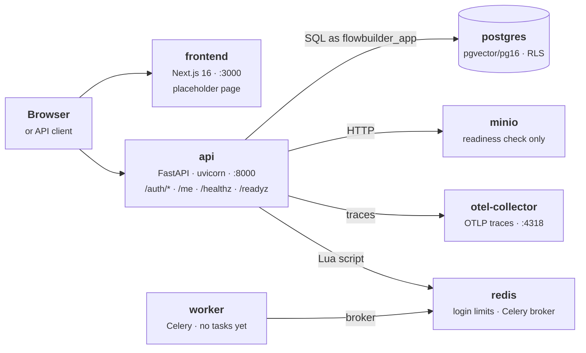
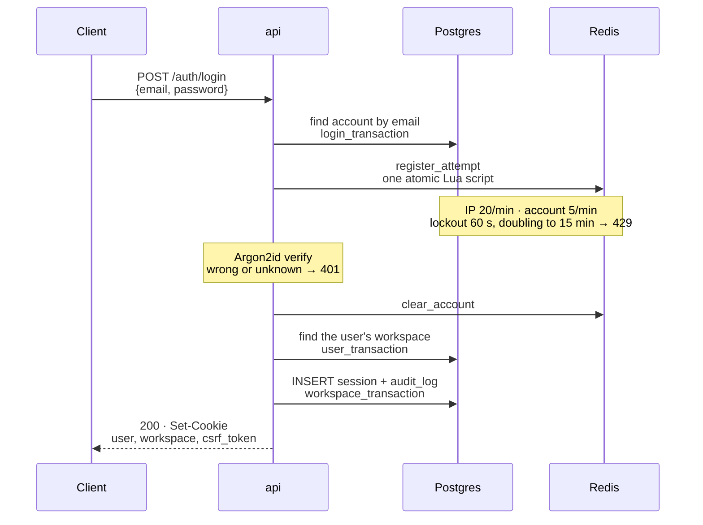
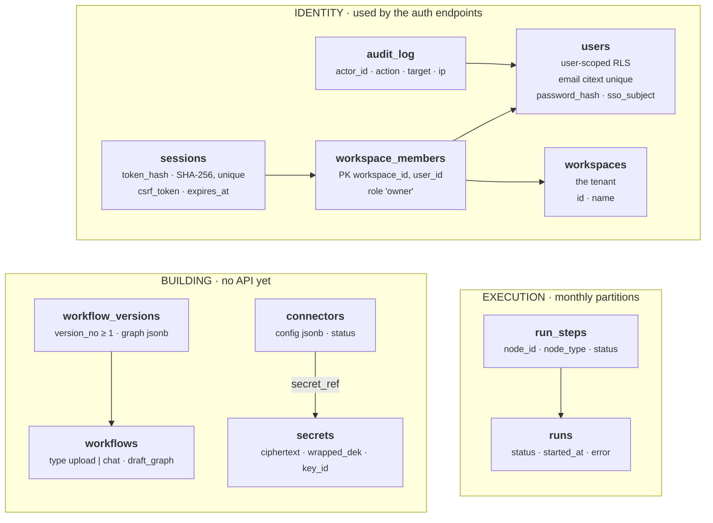

# Foundation and Auth Endpoints

**P01_S01–P01_S04** · 2026-11-13 · The Docker stack, the tenant-isolated schema, and email-and-password signup, login, logout and sessions that every later FlowBuilder feature builds on.

```cards
Built | Docker stack, CI, observability, the full schema with row-level security, signup / login / logout / sessions, health checks.
Scaffold only | The frontend is one placeholder page. The Celery worker runs with no tasks. Workflow, connector and run tables exist with no API yet.
Designed, not built | The workflow runner. A spike proved the design and froze it in `docs/runner-contract.md`; P01_S11 builds it.
```

## What it does

- A visitor signs up with an email and a password of 12+ characters and gets a personal workspace named "Personal", owned by them, plus a signed-in session.
- Login is rate-limited per IP address and per account. Logout ends the session. `GET /me` returns the user, the workspace and the CSRF token for the current session.
- Each workspace is a tenant. Postgres row-level security hides every other workspace's rows, so a missing filter in application code cannot leak data.
- The whole stack starts with one Compose command. `/healthz` and `/readyz` report whether the API and its dependencies are up.

## How it works

### 1. The running system

Everything runs from `infra/docker-compose.yml`, and every port binds to `127.0.0.1` only. Each process connects with only the database role it needs, and Compose enforces the startup order:

```steps
1 · postgres | pgvector/pgvector:pg16 | Healthy once `pg_isready` passes.
2 · db-bootstrap | app.database.bootstrap | Superuser, one-shot. Creates extensions `vector`, `citext` and roles `flowbuilder_owner`, `flowbuilder_app`.
3 · migrate | alembic · app.runs.partitions | Owner, one-shot. `alembic upgrade head`, then run partitions 12 months ahead.
4 · api | app.main | App role. Refuses to start if its role could bypass row-level security, then serves.
```

Figure 1. Startup order. The api also waits for redis, minio and otel-collector to be healthy. The worker needs only redis.

Once up, the services talk to each other like this:



Figure 2. Runtime topology. Blue: built from this repo. Green: stock images that hold data. Amber: observability. Grey: outside the stack.

### 2. How a request is handled

`create_app()` in `main.py` receives every dependency explicitly. Each authenticated request passes through the same layers:

```steps
Middleware | main.py · observability/ | OpenTelemetry span, and one JSON log line per request with status and duration.
Session lookup | identity/authentication.py | Decodes cookie `flowbuilder_session` = `<workspace_id>.<token>`. 401 if missing or unknown.
CSRF + refresh | identity/authentication.py | POST, PUT, PATCH and DELETE must send `X-CSRF-Token`, else 403. Expiry slides at most hourly.
Router → service | api/auth.py → identity/service.py | The router validates and shapes. The service opens a tenancy transaction and runs parameterized SQL.
Postgres RLS | migrations 0002, 0005 | Policies return only the rows of the workspace or user that the transaction acts for.
```

Figure 3. Request path for an authenticated route. Health, signup and login routes skip the session steps.

### 3. Tenant isolation

Every tenant table has `FORCE ROW LEVEL SECURITY` and the policy `USING (workspace_id = app_current_workspace_id())`. `database/tenancy.py` is the only place that sets who a transaction acts for, with `set_config(..., is_local = true)`, so the setting ends with the transaction and never reaches the next user of a pooled connection.

| Context manager | Acts for | Can see | Used by |
| --- | --- | --- | --- |
| `workspace_transaction` | a workspace | that workspace's rows, no `users` rows | session lookup, signup, logout |
| `member_transaction` | workspace + user | the above, plus that user's `users` row | `GET /me`, seed |
| `user_transaction` | a user | that user's row and memberships | login: find the workspace |
| `login_transaction` | an email | the one `users` row with that email, read-only | login: find the account |

> A forged cookie that pairs a valid token with another workspace's id finds nothing: the lookup runs inside that other workspace's transaction, where RLS hides the real session row. At startup, `assert_role_is_subject_to_row_level_security` checks that the app role is not a superuser, has no BYPASSRLS, owns nothing in `public`, and inherits no other role.

### 4. Login and sessions



Figure 4. Login. The attempt is counted before the password is checked, so parallel guesses cannot exceed the limit.

**Sessions.** The token is 32 random bytes, and only its SHA-256 is stored, so a copy of the database cannot be replayed as cookies. The cookie is HttpOnly, SameSite=Lax, with no Domain and a 14-day lifetime. `SESSION_COOKIE_SECURE` has no default. Each session has its own CSRF token, returned in the response body. Expiry slides to 14 days from now, at most once an hour.

**Hardening.**

- An unknown email and a wrong password cost the same work (a dummy hash) and return the same 401.
- Argon2id runs in two small thread pools (hash and verify), off the event loop and bounded in memory.
- 422 bodies omit the input, so a rejected password is never echoed.
- The client IP is the socket peer. `X-Forwarded-For` is ignored (`--no-proxy-headers`).
- Logs redact passwords, tokens, bearer headers, URL credentials and `sk-` keys.

### 5. Data model

Migrations 0001–0005 create eleven tables. Every table except `users` carries `workspace_id` and is filtered by row-level security. Composite foreign keys include `workspace_id`, so a row can never point at another tenant's row.



Figure 5. Schema after migration 0005. Arrows point from a foreign key to the row it references. Grey tables exist but no S01–S04 endpoint uses them. Links from every table to `workspaces`, and from runs to workflows, are omitted.

| Migration | Adds |
| --- | --- |
| `0001_baseline` | `workspaces`, `users`, `workspace_members` |
| `0002_row_level_security_and_sessions` | RLS helper functions and policies on the baseline tables; `sessions` |
| `0003_workflows_connectors_secrets_audit` | `workflows`, `workflow_versions`, `secrets`, `connectors`, `audit_log` |
| `0004_partitioned_runs_and_run_steps` | `runs`, `run_steps`, partitioned by month; `create_run_partitions()` |
| `0005_user_scoped_row_level_security` | Policies on `users` by user id or login email; members see their own memberships |

## Code map

| File path | Class / Function | Role |
| --- | --- | --- |
| `backend/src/app/main.py` | `create_app`, `create_app_from_environment` | App factory: middleware, a 422 handler that hides input, routers, the startup role check |
| `backend/src/app/config.py` | `Settings`, `MigrationSettings`, `BootstrapSettings` | Settings read from the environment |
| `backend/src/app/api/auth.py` | `build_auth_router`, `SignupRequest`, `LoginRequest`, `SessionResponse` | Auth routes; map service errors to 401, 409 and 429 |
| `backend/src/app/api/health.py` | `build_health_router`, `postgres_check`, `redis_check`, `object_storage_check` | Liveness, and readiness checks run in parallel |
| `backend/src/app/identity/service.py` | `sign_up`, `log_in`, `log_out`, `read_identity` | Signup, login and logout logic in tenancy transactions |
| `backend/src/app/identity/authentication.py` | `build_session_dependency`, `set_session_cookie`, `clear_session_cookie` | Cookie to session, CSRF check, sliding refresh |
| `backend/src/app/identity/sessions.py` | `hash_session_token`, `decode_session_cookie`, `find_session`, `extend_session` | Tokens, cookie format, session SQL |
| `backend/src/app/identity/passwords.py` | `PasswordHasher` | Argon2id in bounded thread pools; constant-cost verify |
| `backend/src/app/identity/login_rate_limit.py` | `LoginRateLimiter`, `lockout_seconds` | Per-IP and per-account limits as one Redis Lua script |
| `backend/src/app/audit.py` | `AuditAction`, `record_audit_event` | Audit insert in the caller's transaction |
| `backend/src/app/database/tenancy.py` | `workspace_transaction`, `member_transaction`, `user_transaction`, `login_transaction` | Tells RLS who a transaction acts for |
| `backend/src/app/database/roles.py` | `assert_role_is_subject_to_row_level_security` | Stops the API if its role could bypass RLS |
| `backend/src/app/database/engine.py` | `create_database_engine` | Every async engine, with bound values hidden from errors |
| `backend/src/app/database/bootstrap.py` | `bootstrap_database` | Superuser one-shot: extensions and roles, idempotent |
| `backend/src/app/database/seed.py` | `seed_demo_data` | Demo workspace and a demo user with no password |
| `backend/src/app/runs/partitions.py` | `create_run_partitions` | Monthly `runs` and `run_steps` partitions, 12 months ahead |
| `backend/src/app/observability/` | `configure_logging`, `redact_text`, `build_tracer_provider` | JSON logs with trace ids, secret redaction, OTel export |
| `backend/src/app/worker.py` | `celery_app` | Celery on Redis; no tasks yet |
| `backend/migrations/versions/` | `0001`–`0005` | Hand-written schema, RLS policies and partitions |
| `backend/tests/` | `test_auth`, `test_login`, `test_tenancy`, `test_cross_tenant_probe`, `test_route_protection` | Real Postgres and Redis: auth, limits, RLS, cross-tenant probes |
| `infra/docker-compose.yml` | `db-bootstrap`, `migrate`, `api`, `worker` | The full stack; `.dev.yml` adds live reload, `.test.yml` runs tests |
| `.github/workflows/ci.yml` | `backend`, `frontend`, `docker` | ruff, mypy, pytest; lint, typecheck, test; the stack comes up healthy |
| `spike/`, `docs/runner-contract.md` | runner spike | LangGraph prototype and the frozen v1 runner contract (P01_S01) |

## Notes

- **API endpoints:**
  - `POST /auth/signup`: 201, 409 `email_already_registered`, 422.
  - `POST /auth/login`: 200, 401 `invalid_credentials`, 429 with `Retry-After`, 422.
  - `POST /auth/logout`: 204, 401, 403 `csrf_token_invalid`. Needs `X-CSRF-Token`.
  - `GET /me`: 200, 401.
  - `GET /healthz`: 200. `GET /readyz`: 200, or 503 with a status per check.
- **Configuration:** `SESSION_COOKIE_SECURE` is required. The API logs a warning when it is false. Set it to true everywhere except local development.
- **Postman:** requests and tests for every route are in `postman/collections/FlowBuilder API/`.
- **Limitations:** each user has exactly one workspace, created at signup. There is no SSO, password reset or invite yet. Rate-limit keys for unknown emails are unsalted SHA-256 hashes, which pseudonymize the address rather than hide it.
- **Since S04:** P01_S05 added `crypto/` and migration 0006, and `main.py` now loads the master keyring at startup. See `p01-s05-envelope-encryption-and-key-provider.pdf`.
