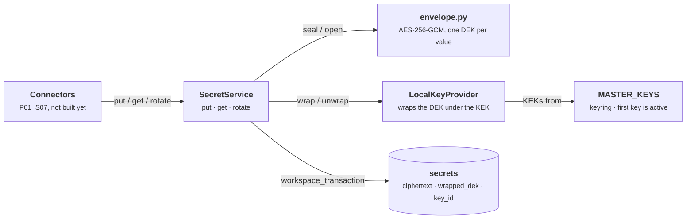

# Envelope Encryption and Key Provider

**P01_S05** · 2026-11-13 · Encrypts every stored secret under its own data key, wrapped by a pluggable key provider, with a master-key rotation that never touches ciphertext.

## What it does

- Connectors (P01_S07) will store API keys and passwords through `SecretService`. Each value is encrypted with AES-256-GCM under a fresh 32-byte data key (DEK), bound to its workspace and secret id.
- The DEK is wrapped by a master key (KEK) from a local keyring in `MASTER_KEYS` or `MASTER_KEYS_FILE`. The database holds only ciphertext, a wrapped DEK and the id of the key that wrapped it.
- The API refuses to start with a missing or weak keyring: the all-zero placeholder, a base64 passphrase, or anything other than 32 random bytes.
- `flowbuilder keys rotate` re-wraps every DEK under a new master key, in every workspace. Reruns are safe, and an interrupted run picks up where it stopped.

## How it works

1. **Put.** The caller opens a `workspace_transaction` and calls `SecretService.put`. It generates the secret id and a fresh DEK, then seals the value with associated data `workspace_id.bytes + secret_id.bytes`.
2. **Wrap.** `LocalKeyProvider.wrap` encrypts the DEK with AES-GCM under the first keyring key, with the same workspace and secret context. The row is inserted with `ciphertext`, `nonce`, `wrapped_dek`, `key_id` and `last4`, where `last4` is filled only for values of 12+ characters.
3. **Get.** `SecretService.get` reads the row, unwraps the DEK with the row's `key_id`, and opens the ciphertext. Moving or swapping any column between rows or workspaces fails with `SecretDecryptionError` instead of returning another secret.
4. **Rotate a value.** `SecretService.rotate` stores a new value under the same id, with a new DEK and nonce, so connectors keep their `secret_ref`.
5. **Rotate the master key.** An operator puts the new key first in the keyring. `rewrap_data_keys` connects as the schema owner and works in batches of 100, locking rows with `FOR UPDATE`. It unwraps each old DEK and wraps it under the active key, and changes only `wrapped_dek` and `key_id`.
6. **Report.** The CLI prints `rewrapped N data keys to <key_id>; M remain under other keys`. It exits 1 while rows remain, or on an unreadable row or a provider that breaks its contract.



Figure 1. Storing and reading a secret. Dashed: a caller that does not exist yet. Green: the only place a secret is stored.

Rotating the master key is a separate, operator-run path:

```steps
New key first | MASTER_KEYS | The operator puts the new key at the front of the keyring and keeps the old ones.
Lock a batch | rewrap_data_keys | As the owner role, selects 100 rows not under the active key, `FOR UPDATE`.
Re-wrap | LocalKeyProvider | Unwraps each DEK with the row's `key_id` and wraps it under the active key.
Write keys only | secrets | Updates `wrapped_dek` and `key_id`. The ciphertext never changes.
Report | flowbuilder keys rotate | Prints the count. Exits 1 while rows remain under other keys.
```

Figure 2. Master-key rotation. Batches repeat until no row is left under an old key, so a rerun picks up where an interrupted one stopped.

The rotation only ever reads and writes the key columns:

```sql
SELECT id, workspace_id, wrapped_dek, key_id FROM secrets
 WHERE key_id <> :active_key_id ORDER BY id LIMIT :batch_size FOR UPDATE;
UPDATE secrets SET wrapped_dek = :wrapped_dek, key_id = :key_id WHERE id = :id;
```

## Code map

| File path | Class / Function | Role |
| --- | --- | --- |
| `backend/src/app/crypto/envelope.py` | `seal`, `open_sealed`, `new_data_key`, `secret_aad`, `last4` | AES-256-GCM for one value; associated data and `last4` rules |
| `backend/src/app/crypto/key_provider.py` | `KeyProvider` | Protocol: `active_key_id`, `wrap(dek, context)`, `unwrap(wrapped, key_id, context)` |
| `backend/src/app/crypto/key_provider.py` | `LocalKeyProvider` | Wraps under the first keyring key, unwraps under any |
| `backend/src/app/crypto/key_provider.py` | `parse_master_keys`, `load_local_key_provider` | Read and validate the keyring; refuse weak keys |
| `backend/src/app/crypto/key_provider.py` | `local_key_id` | Key id: `local:` + 16 hex chars of HMAC-SHA256 |
| `backend/src/app/crypto/key_provider.py` | `KeyringError`, `UnknownKeyIdError`, `KeyUnwrapError` | Errors that name sources and key ids, never keys |
| `backend/src/app/crypto/service.py` | `SecretService.put` / `get` / `rotate` | Store, read and replace a secret in the caller's transaction |
| `backend/src/app/crypto/service.py` | `SecretNotFoundError`, `SecretDecryptionError` | Errors naming the workspace and secret only |
| `backend/src/app/crypto/rotation.py` | `rewrap_data_keys`, `RewrapReport` | Batched re-wrap of every DEK under the active key |
| `backend/src/app/crypto/rotation.py` | `DataKeyRewrapError`, `KeyProviderContractError` | Stop on an unreadable row or a misbehaving provider |
| `backend/src/app/cli.py` | `main`, `build_parser`, `rotate_keys` | The `flowbuilder keys rotate` command and its exit codes |
| `backend/src/app/config.py` | `KeyringSettings` | Exactly one of `MASTER_KEYS` and `MASTER_KEYS_FILE` |
| `backend/src/app/main.py` | `create_app_from_environment` | Loads the keyring at startup, so a weak key stops the API |
| `backend/migrations/versions/0006_secrets_key_rotation_policies.py` | `upgrade`, `downgrade` | Owner SELECT and UPDATE policies on `secrets` |
| `infra/docker-compose.yml` | `api`, `rotate-keys` | `MASTER_KEYS` for the API; one-shot rotation (profile `maintenance`) |
| `backend/tests/crypto/` | `test_envelope`, `test_key_provider`, `test_service`, `test_rotation` | Property, AAD, rotation, resume and lock-race tests |

## Notes

- **Configuration:** `MASTER_KEYS` (the compose stack uses this) or `MASTER_KEYS_FILE`. Generate a key with `openssl rand -base64 32`. The API and `rotate-keys` hold the keys; the worker does not.
- **Running a rotation:** `docker compose --env-file .env -f infra/docker-compose.yml run --build --rm rotate-keys`. Follow the two-phase rollout in `docs/key-providers.md` before running it.
- **API:** no endpoints yet. P01_S07 adds the connector routes that call `SecretService`.
- **Limitations:**
  - The owner policies guard against mistakes; they are not a security boundary against the owner role.
  - One row whose key is missing from the keyring stops every rotation until it is resolved.
  - A random wrap nonce limits one master key to about 2^32 wraps.
  - Vault and AWS KMS providers are designed in `docs/key-providers.md`, not built (P06_S09).
