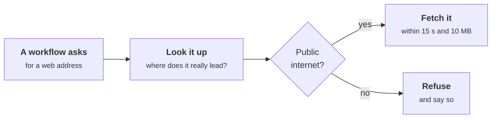
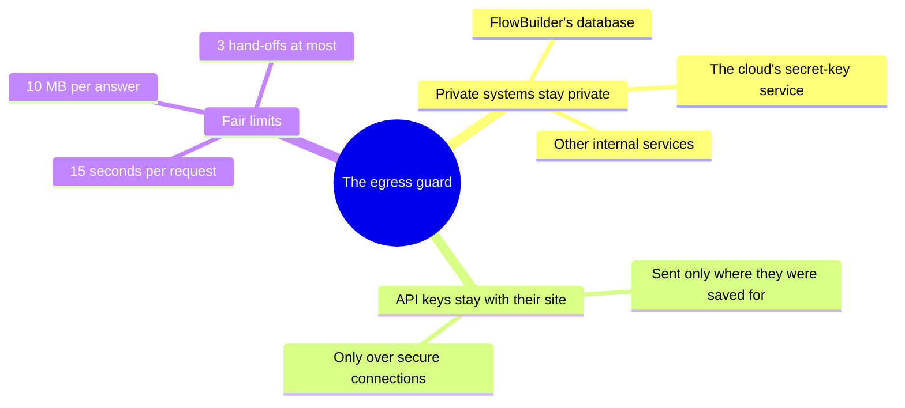
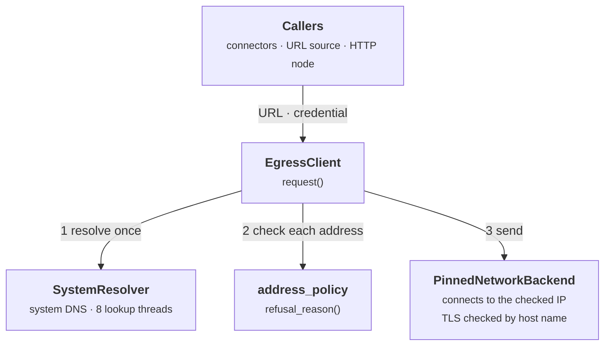
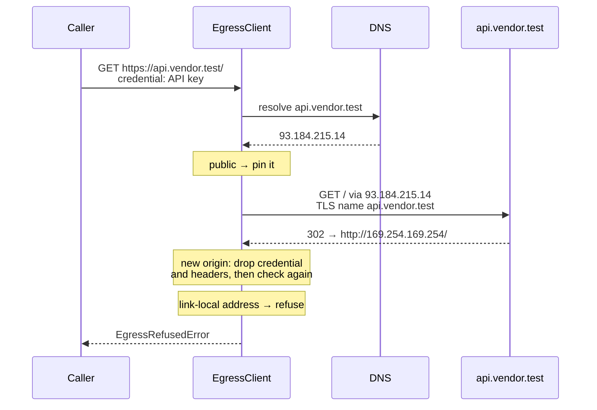
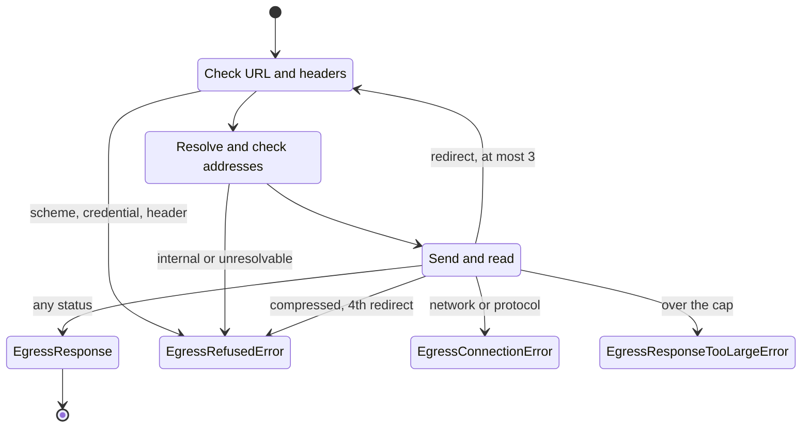

# Egress Guard HTTP Client

**P01_S06** · 2026-11-13 · One outbound HTTP client that every user-, connector- and node-supplied URL goes through, so none of them can reach an internal address (SSRF).

```cards
Built | The guard itself, its safety rules, and an automatic check that stops new code from skipping it.
Not used yet | Connectors (P01_S07), web-page sources (P02_S02) and the HTTP Request step (P03_S06) will be its first users.
Later | Each workspace choosing which websites are allowed (P03_S07).
```

```part
Part 1 | The short version | For everyone. No technical background needed.
```

## What it is

FlowBuilder will soon fetch things from the internet for you: web pages, files, and answers from services such as OpenAI. The egress guard is the gatekeeper for every one of those trips.

Think of a building's post room. It will send your letter to any address in the world, but it will never deliver one to the building's own server room. The guard works the same way: the public internet is fine, and FlowBuilder's private systems are off limits.

## Why it matters

```compare
Without the guard | With the guard
Anyone who can type a web address into a workflow could point FlowBuilder at its own database, or at the cloud's store of secret keys. | Addresses inside FlowBuilder's private network are refused before anything is sent.
A saved API key could be passed on to whatever website a link leads to. | A key only ever goes to the one website it was saved for, over a secure connection.
One slow or huge download could tie FlowBuilder up. | Every request stops after 15 seconds or 10 MB.
A future feature could forget the safety checks. | The checks live in one place, and code that skips them is rejected automatically.
```

## How it works, in plain words

Before every trip, the guard looks up where the web address really leads, because a friendly-looking name can point somewhere private. Only then does it decide.



Figure 1. Every request, and every hand-off to another address, goes through this check. Nothing is sent until the answer is "public".



Figure 2. What the guard protects, at a glance.

## Examples

```examples
ok | A workflow downloads a report from a public website. | The report arrives as normal.
ok | A connector calls an AI service with its saved API key. | The key goes to that service over a secure connection, and the answer comes back.
ok | A website hands the request on to another website. | The trip continues, but the API key stays behind. It is never shown to the second website.
fail | Someone types the address of the cloud's secret-key service into a workflow. | Refused before anything is sent. The workflow shows "the host does not resolve to an allowed address".
fail | A public website tries to hand the request on to a private address. | Refused at the hand-off. The private address is never contacted.
fail | A download is larger than 10 MB, or takes longer than 15 seconds. | It stops, and the workflow reports that the answer was too large or too slow.
```

## What it does not do yet

- Nothing in FlowBuilder uses it yet. Connectors, web-page sources and the HTTP Request step will be the first.
- Every public website is allowed. Letting a workspace limit itself to a list of approved websites comes later.
- An insecure (http) address can't yet be allowed per workspace. For now, each feature decides when it calls the guard.

```part
Part 2 | How it works | For engineers working on FlowBuilder.
```

## Components



Figure 3. Components of one outbound request, in the order the client uses them. Dashed: callers that later subphases build.

## Every hop

```steps
1 · Check the URL | client.py | https only, unless `allow_plain_http`. No `user:pass@`. A credential only over https.
2 · Resolve once | resolver.py | One lookup per hop, on its own threads, so slow DNS can't starve the process.
3 · Check every address | address_policy.py | If any answer is internal, the whole host is refused, so a mixed answer can't slip one through.
4 · Pin and send | pinned_network.py | Connects only to the checked IP. TLS still verifies the certificate against the host name.
5 · Read or redirect | client.py | Counts body bytes up to the cap, and refuses compressed bodies. A redirect goes back to step 1.
```

Figure 4. The per-hop checks. The 15 s deadline covers all hops together, and a 4th redirect is refused.

> **The client connects only to an address it has checked.** It checks the resolved address, not the URL's text, so every spelling of a host reaches the same decision, and pinning the connection means a DNS answer that changes after the check is never used.

## A redirect to an internal address



Figure 5. A redirect re-runs every check. The metadata service is never contacted, and the API key would not have followed the redirect even to a public host.

## Examples

```examples
ok | `request("GET", "https://api.example.test/v1")` | `EgressResponse(status_code=200, …)`. The connection goes to the resolved IP, and TLS checks the name `api.example.test`.
ok | A 302 to `/next` on the same origin, with a credential and `X-Api-Key` | Followed. The credential and the header are sent again.
ok | A 302 to `https://other.example.test/` | Followed, without the credential or caller headers, which stay with the first origin for good.
fail | `GET https://169.254.169.254/latest/meta-data/` | `EgressRefusedError`: "refused request to https://169.254.169.254: the host does not resolve to an allowed address". `.detail` names the link-local address, for logs.
fail | `GET http://api.example.test/` without `allow_plain_http` | `EgressRefusedError`: "the 'http' scheme is not allowed".
fail | A credential on an `http://` URL, even with `allow_plain_http=True` | `EgressRefusedError`: "a credential is only sent over https".
fail | `headers={"Content-Length": "5"}` (also `Host`, `Transfer-Encoding`, `Proxy-*`) | `EgressRefusedError`: "the Content-Length header is set by the egress client".
fail | A header value containing CR, LF or NUL | `EgressRefusedError` naming the header, never its value. Nothing is sent.
fail | A 307 to another origin with a request body | `EgressRefusedError`: "a redirect to another origin would resend the request body".
fail | A 4th redirect | `EgressRefusedError`: "more than 3 redirects". The 4th target is never contacted.
fail | A body over `max_response_bytes` | `EgressResponseTooLargeError`: "response from https://api.example.test exceeded 10485760 bytes".
fail | `Content-Encoding: gzip` in the response | `EgressRefusedError`: "the response body is compressed".
fail | A server that stops answering | `EgressTimeoutError`: "request to … took longer than 15.0 seconds", naming the origin that stalled.
fail | Connection refused, a TLS failure, or a malformed response | `EgressConnectionError` with the error type, such as `ConnectError` or `RemoteProtocolError`.
```

## How a request ends



Figure 6. Every way one call can end. Each failure is an `EgressError` subclass, and an `EgressTimeoutError` can end the call in any state once the 15 s deadline passes.

## What the policy refuses

| Kind | Addresses |
| --- | --- |
| IPv4 | `0/8`, `10/8`, `100.64/10` (CGNAT), `127/8`, `169.254/16` (link-local, metadata), `172.16/12`, `192.168/16`, `192.0.0/24`, documentation and benchmarking ranges, multicast `224/4`, reserved `240/4` |
| IPv6 | `::1`, `::`, ULA `fc00::/7` (includes `fd00:ec2::254`), link-local `fe80::/10`, multicast `ff00::/8`, NAT64 `64:ff9b::/96`, 6to4 `2002::/16`, documentation `2001:db8::/32`, and anything outside the internet unicast range `2000::/3` |
| Embedded IPv4 | `::ffff:a.b.c.d` takes the verdict of `a.b.c.d`. IPv4-compatible and IPv4-translated forms fall outside `2000::/3`. |
| Fallback | Anything else Python's `ipaddress` says is not global |

## Code map

| File path | Class / Function | Role |
| --- | --- | --- |
| `backend/src/app/egress/client.py` | `EgressClient.request` | One deadline around up to 4 hops; the only public entry point |
| `backend/src/app/egress/client.py` | `EgressCredential`, `EgressResponse` | The per-request credential, and the response returned to callers |
| `backend/src/app/egress/client.py` | `EgressRefusedError`, `EgressConnectionError`, `EgressResponseTooLargeError`, `EgressTimeoutError` | Every failure subclasses `EgressError` and names only the origin |
| `backend/src/app/egress/client.py` | `_validated_headers`, `CLIENT_SET_HEADERS` | Refuses reserved, duplicated or line-breaking headers before sending |
| `backend/src/app/egress/client.py` | `_next_hop` | Redirect rules: method switch, body, and origin-scoped headers and credential |
| `backend/src/app/egress/address_policy.py` | `refusal_reason`, `BLOCKED_NETWORKS`, `IPV6_GLOBAL_UNICAST` | Pure check of one IP address, with the reason for logs |
| `backend/src/app/egress/resolver.py` | `SystemResolver`, `Resolver` | System DNS lookups on a bounded thread pool of their own |
| `backend/src/app/egress/pinned_network.py` | `PinnedNetworkBackend` | httpcore backend that connects only to the checked address |
| `backend/pyproject.toml` | `banned-api`, `per-file-ignores` | Raw HTTP imports fail lint outside `egress/` and the readiness check |
| `backend/tests/egress/` | `test_ssrf_corpus`, `test_egress_client`, `test_address_policy`, `test_raw_http_import_ban` | The SSRF corpus, redirect and credential rules, limits, the lint ban |
| `backend/tests/support/fake_network.py` | `FakeNetwork`, `FakeResolver` | Fake sockets and DNS that record where each connection went |

## Notes

- **Usage**, as P01_S07 will call it:

  ```python
  client = EgressClient()  # one per process; defaults: 15 s, 10 MB
  response = await client.request(
      "GET",
      connector.base_url,
      credential=EgressCredential("Authorization", SecretStr(f"Bearer {api_key}")),
  )
  ```

- **Configuration:** no env vars. `timeout_seconds` and `max_response_bytes` are constructor arguments, and `allow_plain_http` is a per-call flag.
- **API:** no endpoints changed.
- **Limitations:**
  - There's no domain allowlist yet (P03_S07). Any public host is reachable.
  - A new connection is opened for every hop, with no reuse across calls.
  - It pins the first resolved address and doesn't fall back to another (no Happy Eyeballs).
  - The import ban covers seven HTTP libraries. SDKs that make their own HTTP calls (openai, boto3) need an egress-backed transport when they arrive.
  - It has only been tested against fake DNS and sockets, not a live TLS request to the internet.
