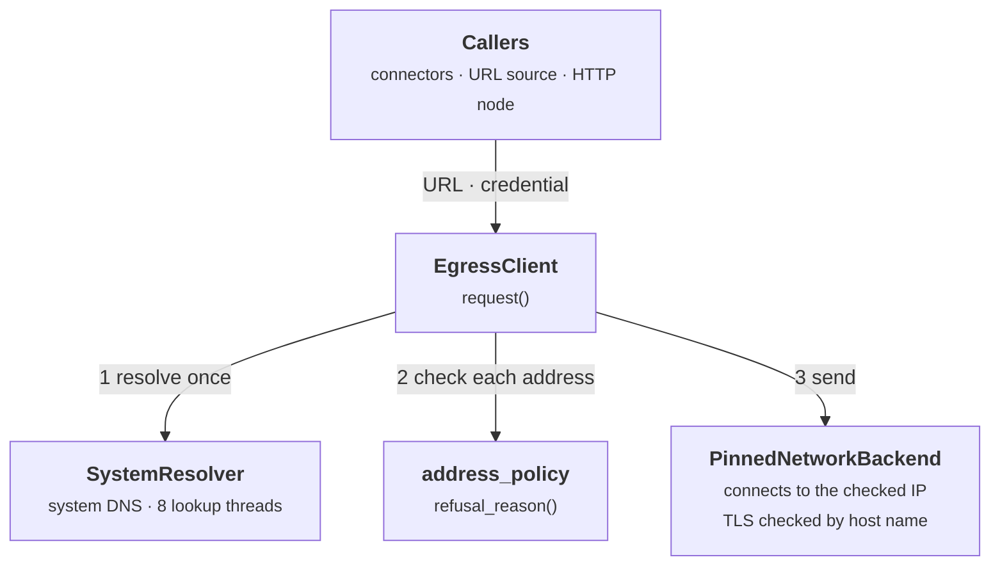
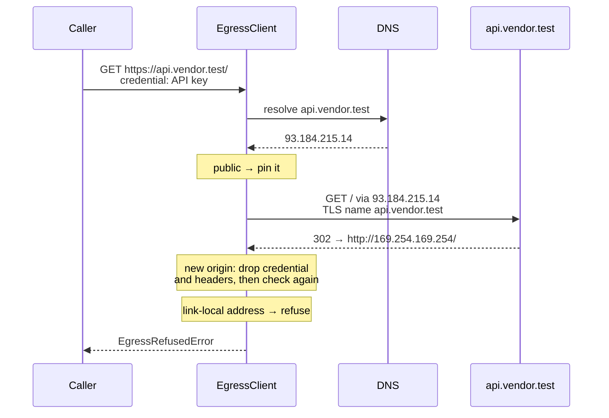

# Egress Guard HTTP Client

**P01_S06** · 2026-11-13 · One outbound HTTP client that every user-, connector- and node-supplied URL goes through, so none of them can reach an internal address (SSRF).

```cards
Built | `EgressClient`, the address policy, a bounded DNS resolver, the SSRF corpus suite, and a lint rule that bans raw HTTP imports.
No callers yet | Connector tests (P01_S07), the URL source (P02_S02) and the HTTP Request node (P03_S06) will be its first users.
Later | The per-workspace plain-http setting and domain allowlist (P03_S07). Until then, callers pass `allow_plain_http`.
```

## What it does

- A request to an internal address is refused before any connection is opened. That covers cloud metadata (`169.254.169.254`), `localhost`, private and Docker network addresses, and every disguise of them: `127.1`, `0x7f000001`, `[::ffff:127.0.0.1]`, redirects, and DNS answers that change.
- A credential, such as an API key, is sent only over https, only to the URL's own origin, and never follows a redirect elsewhere.
- Every call is bounded: 15 s for the whole call, redirects included, a 10 MB response cap, and at most 3 redirects.
- Code under `backend/src/app/` cannot bypass the guard: a raw `httpx`, `requests` or `urllib.request` import fails lint.

## How it works

### 1. Where it sits



Figure 1. Components of one outbound request, in the order the client uses them. Dashed: callers that later subphases build.

### 2. What happens on every hop

Every request, and every redirect it follows, goes through the same five checks:

```steps
1 · Check the URL | client.py | https only, unless `allow_plain_http`. No `user:pass@`. A credential only over https.
2 · Resolve once | resolver.py | One lookup per hop, on its own threads, so slow DNS can't starve the process.
3 · Check every address | address_policy.py | If any answer is internal, the whole host is refused, so a mixed answer can't slip one through.
4 · Pin and send | pinned_network.py | Connects only to the checked IP. TLS still verifies the certificate against the host name.
5 · Read or redirect | client.py | Counts body bytes up to the cap, and refuses compressed bodies. A redirect goes back to step 1.
```

Figure 2. The per-hop checks. The 15 s deadline covers all hops together, and a 4th redirect is refused.

> **The client connects only to an address it has checked.** It checks the resolved address, not the URL's text, so every spelling of a host reaches the same decision, and pinning the connection means a DNS answer that changes after the check is never used.

### 3. A redirect to an internal address



Figure 3. A redirect re-runs every check. The metadata service is never contacted, and the API key would not have followed the redirect even to a public host.

### 4. What the policy refuses

| Kind | Addresses |
| --- | --- |
| IPv4 | `0/8`, `10/8`, `100.64/10` (CGNAT), `127/8`, `169.254/16` (link-local, metadata), `172.16/12`, `192.168/16`, `192.0.0/24`, documentation and benchmarking ranges, multicast `224/4`, reserved `240/4` |
| IPv6 | `::1`, `::`, ULA `fc00::/7` (includes `fd00:ec2::254`), link-local `fe80::/10`, multicast `ff00::/8`, NAT64 `64:ff9b::/96`, 6to4 `2002::/16`, documentation `2001:db8::/32`, and anything outside the internet unicast range `2000::/3` |
| Embedded IPv4 | `::ffff:a.b.c.d` takes the verdict of `a.b.c.d`. IPv4-compatible and IPv4-translated forms fall outside `2000::/3`. |
| Fallback | Anything else Python's `ipaddress` says is not global |

Callers see one message for any host they can't reach, "the host does not resolve to an allowed address", so errors can't be used to map internal DNS. The actual address is kept in `EgressRefusedError.detail`, for server logs only.

### 5. Headers and credentials

- `EgressCredential` is a header name plus a `SecretStr`. It goes only to the URL's origin, only over https, and is dropped for good when a redirect changes the scheme, host or port.
- Caller headers are dropped on an origin change too. A 307 or 308 to another origin that would resend the body is refused.
- The client sets `Host`, `Accept-Encoding: identity` and the framing headers itself. A caller that sets them, or `Proxy-*`, is refused, which blocks request smuggling against the remote server.
- A header containing CR, LF or NUL is refused before sending. No error message quotes a header value, a path or a query string, only the origin.

## Code map

| File path | Class / Function | Role |
| --- | --- | --- |
| `backend/src/app/egress/client.py` | `EgressClient.request` | One deadline around up to 4 hops; the only public entry point |
| `backend/src/app/egress/client.py` | `EgressCredential`, `EgressResponse` | The per-request credential, and the response returned to callers |
| `backend/src/app/egress/client.py` | `EgressRefusedError`, `EgressConnectionError`, `EgressResponseTooLargeError`, `EgressTimeoutError` | Every failure subclasses `EgressError` and names only the origin |
| `backend/src/app/egress/client.py` | `_validated_headers`, `CLIENT_SET_HEADERS` | Refuses reserved, duplicated or line-breaking headers before sending |
| `backend/src/app/egress/client.py` | `_next_hop` | Redirect rules: method switch, body, and origin-scoped headers and credential |
| `backend/src/app/egress/address_policy.py` | `refusal_reason`, `BLOCKED_NETWORKS`, `IPV6_GLOBAL_UNICAST` | Pure check of one IP address, with the reason for logs |
| `backend/src/app/egress/resolver.py` | `SystemResolver`, `Resolver` | System DNS lookups on a bounded thread pool of their own |
| `backend/src/app/egress/pinned_network.py` | `PinnedNetworkBackend` | httpcore backend that connects only to the checked address |
| `backend/pyproject.toml` | `banned-api`, `per-file-ignores` | Raw HTTP imports fail lint outside `egress/` and the readiness check |
| `backend/tests/egress/` | `test_ssrf_corpus`, `test_egress_client`, `test_address_policy`, `test_raw_http_import_ban` | The SSRF corpus, redirect and credential rules, limits, the lint ban |
| `backend/tests/support/fake_network.py` | `FakeNetwork`, `FakeResolver` | Fake sockets and DNS that record where each connection went |

## Notes

- **Usage**, as P01_S07 will call it:

  ```python
  client = EgressClient()  # one per process; defaults: 15 s, 10 MB
  response = await client.request(
      "GET",
      connector.base_url,
      credential=EgressCredential("Authorization", SecretStr(f"Bearer {api_key}")),
  )
  ```

- **Configuration:** no env vars. `timeout_seconds` and `max_response_bytes` are constructor arguments, and `allow_plain_http` is a per-call flag.
- **API:** no endpoints changed.
- **Limitations:**
  - There's no domain allowlist yet (P03_S07). Any public host is reachable.
  - A new connection is opened for every hop, with no reuse across calls.
  - It pins the first resolved address and doesn't fall back to another (no Happy Eyeballs).
  - The import ban covers seven HTTP libraries. SDKs that make their own HTTP calls (openai, boto3) need an egress-backed transport when they arrive.
  - It has only been tested against fake DNS and sockets, not a live TLS request to the internet.
